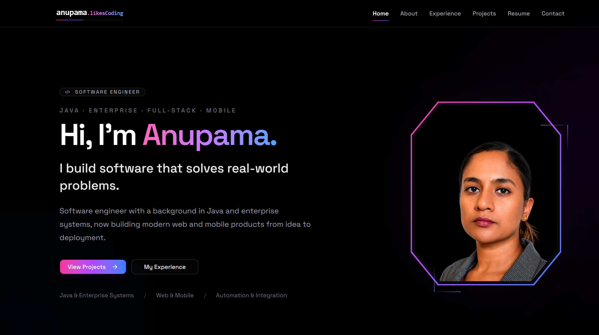

# Anupama Rajendra — Developer Portfolio

A modern, bilingual **English / German (EN / DE)** personal developer portfolio presenting my experience across **Java, enterprise systems, SQL, Unix / Shell Scripting, full-stack web development, mobile applications, and independent software projects**.

Built to showcase my professional background, technical skills, independent development work, and selected projects to employers in Switzerland and internationally.

## Live Portfolio

🌐 **English Portfolio:**  
https://A-nu-1.github.io/anupamaportfolio/

🇨🇭 **Deutsches Portfolio:**  
https://A-nu-1.github.io/anupamaportfolio/?lang=de

📄 **German Resume / Lebenslauf:**  
https://A-nu-1.github.io/anupamaportfolio/resume?lang=de

Both languages are supported within the same React application.



---

## About This Portfolio

This portfolio brings together my professional experience, recent independent software development, selected projects, technical skills, and résumé in one place.

The site is designed to be:

- Professional and recruiter-friendly
- Fully bilingual in English and German
- Responsive across desktop, tablet, and mobile
- Easy to navigate
- Suitable for technical and non-technical visitors
- Useful for English- and German-speaking job applications
- Printable and ATS-friendly
- Accessible through language-specific URLs

---

## Bilingual Portfolio — English / Deutsch

The portfolio includes an **EN / DE language toggle** that allows visitors to switch between English and German.

### Features

- English as the default language
- German translation of all main portfolio pages
- Desktop and mobile language switcher
- Language selection preserved during navigation
- Language-specific URLs for sharing
- Professional German translations using Swiss spelling
- Bilingual project descriptions and case studies
- English and German résumé content
- Language-specific TXT downloads and PDF printing

### Language-Specific URLs

English:

```text
https://A-nu-1.github.io/anupamaportfolio/
```

German:

```text
https://A-nu-1.github.io/anupamaportfolio/?lang=de
```

German résumé:

```text
https://A-nu-1.github.io/anupamaportfolio/resume?lang=de
```

German project case study:

```text
https://A-nu-1.github.io/anupamaportfolio/projects/client-commerce?lang=de
```

Language selection is managed through React Context and URL search parameters.

No separate German website or repository is required.

---

## Main Sections

### Home / Startseite

A concise overview of my background, featured work, career experience, and contact information.

Includes:

- Software engineering introduction
- Professional summary
- Featured projects
- Career overview
- Technical expertise
- Contact call-to-action

All content is available in English and German.

### About / Über mich

My engineering journey from **Java and enterprise software development** to modern web and mobile application development.

Includes:

- Professional introduction
- Engineering approach
- Automation and problem-solving philosophy
- Technical skills
- Education
- Language proficiency

### Experience / Berufserfahrung

An interactive professional timeline covering:

- Independent software development
- Credit Suisse
- Cognizant Switzerland
- Meyer Burger
- Applied Materials
- Cisco

Each experience entry includes:

- Employment period
- Role and organisation
- Professional responsibilities
- Technical achievements
- Technologies used

The complete timeline is available in English and German.

### Projects / Projekte

Selected work including:

- Client Commerce Platforms
- Bhajans
- SupportDesk
- Travel Planner
- Ecommerce Application
- Solar System
- React CuteBot
- Store Stories

Features include:

- Bilingual project descriptions
- Featured project case studies
- Technology badges
- GitHub repositories
- Live application links
- Interactive screenshot galleries
- Fullscreen image previews
- Mobile swipe navigation

### Resume / Lebenslauf

A bilingual résumé designed for professional job applications.

Includes:

- Professional summary
- Technical skills
- Clear MM/YYYY employment timelines
- Professional experience
- Selected software projects
- Education
- Language proficiency
- Swiss work authorization

The résumé supports:

- **Copy Resume / Lebenslauf kopieren**
- **Download TXT / TXT herunterladen**
- **Print Resume / Lebenslauf drucken**
- **Save as PDF**

All actions respect the currently selected language.

### Contact / Kontakt

A bilingual contact page powered by EmailJS.

Includes:

- Professional availability
- Location information
- GitHub profile
- Email contact
- Swiss C Permit information
- Contact form
- Form validation
- Submission progress
- Success and error feedback

The form retains its original EmailJS integration while translating the user-facing interface.

---

## Featured Projects

### Client Commerce Platforms

Two independently developed ecommerce ecosystems for small businesses:

- **Lucky's Collection**
- **A Home Cook**

Both platforms include web and Android applications.

Key capabilities:

- Product storefronts
- Product and category administration
- Shopping cart and checkout
- Customer order management
- Administrative dashboards
- Email/password and Google authentication
- Notifications
- Analytics and visitor monitoring
- AI-assisted product workflows
- Natural-language product discovery
- Caching and performance optimisation
- Configurable storefront settings
- Catalog mode
- Mobile customer and administrative workflows

The systems were designed around a goal of keeping infrastructure costs at **0 CHF wherever feasible**.

The portfolio includes a complete bilingual case study explaining architecture, features, and cost-conscious engineering decisions.

---

### Bhajans

A multilingual devotional lyrics platform developed as a personal contribution to my spiritual community.

The application replaces large, difficult-to-manage song files with an accessible digital collection.

Features include:

- Fast song search
- Devotional categories
- Favorites
- Structured paragraph-based reading
- Previous / next song navigation
- Multilingual content
- Kannada, English, and Hindi support
- Transliteration tools
- Bulk paragraph conversion
- Language configuration
- Administrative tools
- Web and Android applications
- YouTube integration

The portfolio contains a bilingual case study describing the motivation, user experience, administration tools, and technical implementation.

---

### SupportDesk

A full-stack IT support ticket system designed to demonstrate enterprise-style application architecture.

Includes:

- Employee ticket workflows
- Support-agent workflows
- Administrative functionality
- Role-based access control
- Authentication using JWT
- Ticket management
- Enterprise-style backend architecture

**Technologies:** Java, Spring Boot, Angular, PostgreSQL, Spring Security, JWT, Docker.

---

### Travel Planner

A travel-planning application designed to simplify trip organisation.

Features include:

- Trip creation
- Destination management
- Day-by-day itineraries
- Interactive maps
- Travel dashboards
- Drag-and-drop planning
- Travel history
- Interactive globe visualisation

---

### Ecommerce Application

A full-stack ecommerce application supporting:

- Product browsing
- Product ratings
- Cart management
- Checkout
- Delivery options
- Order history
- Reordering
- Shipment tracking

**Technologies:** React, Express, Sequelize, SQL.

---

## Technical Stack

### Core Engineering

- Java
- J2EE
- Spring
- Hibernate
- Object-Oriented Programming
- SQL
- Unix
- Shell Scripting

### Frontend

- React
- Vite
- JavaScript
- TypeScript
- Next.js
- Tailwind CSS
- shadcn/ui
- Lucide Icons

### Mobile

- React Native
- Expo

### Backend & Data

- Node.js
- PostgreSQL
- Supabase
- Prisma
- Oracle
- MSSQL
- REST APIs

### Integration & Operations

- MQ
- File Transfer
- Enterprise Integration
- Production Support
- Monitoring
- Automation

### Portfolio-Specific Technologies

- React 19
- Vite 8
- React Router 7
- React Context API
- URL Search Parameters
- Tailwind CSS 4
- Geist Variable
- EmailJS
- GitHub Pages
- GitHub Actions

---

## Internationalization Architecture

The portfolio uses a lightweight, custom internationalization system without requiring an additional translation library.

Language management consists of:

- A shared React language context
- A reusable `useLanguage()` hook
- Translation objects for English and German
- URL-based language selection
- Localized internal navigation
- Language-aware résumé exports

### Language Context

The context provides:

```javascript
{
  language,
  setLanguage,
  t
}
```

Components access the current language using:

```jsx
import { useLanguage } from "@/i18n/useLanguage";

const { language } = useLanguage();
```

For German, the application uses:

```text
?lang=de
```

When the language parameter is absent, English is used.

### Translation Approach

- User-facing text is translated.
- Technology names remain unchanged.
- Company and project names remain unchanged.
- Links and application behavior are shared.
- German wording follows Swiss-standard conventions.

This keeps maintenance simple while supporting recruiters from different language backgrounds.

---

## UI / Design

The portfolio uses a dark, minimal visual design with subtle pink, purple, and blue accent gradients.

Design goals include:

- Professional presentation
- Strong readability
- Consistent typography across both languages
- Responsive layouts
- Restrained animations
- Accessible navigation
- Clear content hierarchy
- Visual project storytelling

**Geist Variable** provides consistent typography for English and German content.

---

## Responsive Features

The portfolio supports desktop, tablet, and mobile devices.

Features include:

- Responsive desktop navigation
- Mobile navigation drawer
- EN / DE language toggle on desktop and mobile
- Touch-friendly project galleries
- Swipeable image carousels
- Click-to-expand screenshots
- Responsive project cards
- Responsive case studies
- Mobile-friendly résumé layout
- Layouts accommodating longer German text

---

## Bilingual Resume Features

The résumé is designed around real recruitment and job-application workflows.

Both language versions include:

- Professional experience
- Month/year employment history
- Technical competencies
- Java and enterprise integration experience
- SQL and Unix / Shell Scripting
- Modern web and mobile development
- Selected projects
- Education
- Language information
- Swiss C Permit

### Copy Resume

Copies the full résumé in the currently selected language.

### Download TXT

Downloads an ATS-friendly plain-text version.

English:

```text
Anupama_Rajendra_Resume_EN.txt
```

German:

```text
Anupama_Rajendra_Lebenslauf_DE.txt
```

### Print / Save as PDF

Opens a print-friendly A4 résumé that can be printed or saved as PDF.

The document is generated in the currently selected language.

### Shared Resume Data

The visible résumé and text exports use the same language-specific data.

This ensures consistency between:

- On-screen résumé
- Copied text
- Downloaded TXT
- Printed document

---

## Project Structure

```text
src/
├── assets/
│   └── projects/
├── components/
│   ├── sections/
│   └── ui/
├── i18n/
│   ├── LanguageContext.jsx
│   ├── language-context.js
│   └── useLanguage.js
├── pages/
├── lib/
├── App.jsx
├── App.css
├── index.css
└── main.jsx
```

The application uses reusable components and shared language state, while keeping page-specific translations close to their components.

---

## Running Locally

Clone the repository:

```bash
git clone https://github.com/A-nu-1/anupamaportfolio.git
```

Open the project directory:

```bash
cd anupamaportfolio
```

Install dependencies:

```bash
npm install
```

Start the development server:

```bash
npm run dev
```

Local application:

```text
http://localhost:5173/
```

German version:

```text
http://localhost:5173/?lang=de
```

---

## Environment Variables

The contact form uses EmailJS.

Create a `.env` file in the project root:

```env
VITE_SERVICE_ID=your_service_id
VITE_TEMPLATE_ID=your_template_id
VITE_PUBLIC_KEY=your_public_key
```

Do not commit your local `.env` file.

For GitHub Pages deployment, configure the corresponding environment variables through the GitHub Actions workflow and repository settings.

---

## Code Quality

The project uses ESLint and Vite production builds.

Run lint checks:

```bash
npm run lint
```

Create a production build:

```bash
npm run build
```

The production output is generated in:

```text
dist/
```

---

## Deployment

The portfolio is deployed using:

- **GitHub Pages**
- **GitHub Actions**

The Vite production base path is:

```text
/anupamaportfolio/
```

The GitHub Actions deployment workflow builds and publishes the production application.

The portfolio uses one deployment for both languages.

English:

https://A-nu-1.github.io/anupamaportfolio/

German:

https://A-nu-1.github.io/anupamaportfolio/?lang=de

---

## Routing

The portfolio uses React Router for client-side navigation.

Main routes include:

```text
/
/about
/experience
/projects
/projects/bhajans
/projects/client-commerce
/resume
/contact
```

The GitHub Pages deployment includes an SPA routing fallback for opening supported routes directly.

German pages use the same routes with a language parameter:

```text
/?lang=de
/about?lang=de
/experience?lang=de
/projects?lang=de
/projects/bhajans?lang=de
/projects/client-commerce?lang=de
/resume?lang=de
/contact?lang=de
```

This allows direct sharing of German pages with recruiters and employers.

---

## Author

### Anupama Rajendra

**Software Engineer · Full-Stack Developer**

Java · SQL · Unix / Shell Scripting · Enterprise Integration · Full-Stack · Mobile

📍 Mägenwil, Aargau, Switzerland  
🇨🇭 Swiss C Permit

### Links

**Portfolio (English)**  
https://A-nu-1.github.io/anupamaportfolio/

**Portfolio (Deutsch)**  
https://A-nu-1.github.io/anupamaportfolio/?lang=de

**GitHub**  
https://github.com/A-nu-1

---

Thanks for visiting!

*Vielen Dank für Ihren Besuch!*
